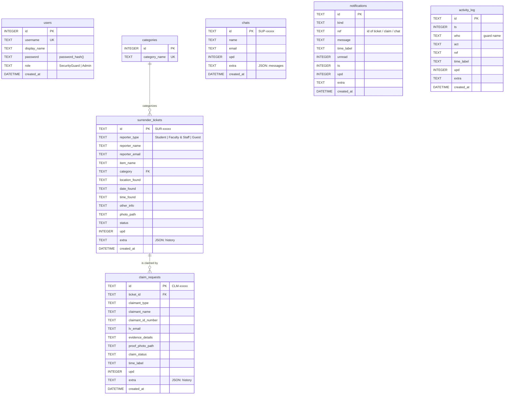

# Database schema

SQLite file `data/la_verdad_found.db`, created from `schema.sql`. This replaces the earlier ERD
(`docs/original/La_Verdad_Found_ERD.drawio.pdf`), which described a different, normalised layout the app never used.

## ERD



`notifications.ref`, `activity_log.ref` and `chats` are intentionally **not** foreign keys: a notification or log line must
survive when the ticket it mentions is deleted, and chats are about an email address, not an item.
Re-draw this in draw.io for the final report if you need the original style (the Mermaid block above can be pasted at
<https://mermaid.live> and exported as an image).

## What changed from the old ERD, and why

| Old ERD / old `Setup.php` | Now | Reason |
|---|---|---|
| Integer ids | Text ids `SUR-…`, `CLM-…`, `SUP-…` | The app creates the ids in the browser (also while offline). |
| `stored_items` table | removed — an item is a ticket whose `status = 'Stored'` | The app has no separate "stored item" record; claims point at the ticket. |
| `claim_requests.stored_item_id` | `claim_requests.ticket_id` | Same reason. `ON DELETE CASCADE`: deleting a ticket deletes its claims. |
| `surrender_tickets.category_id` | `category` (text) → `categories.category_name` | The app stores the category name. Six categories: Bags, Gadgets, IDs & Cards, Clothing, Accessories, Others. |
| `item_type` Lost/Found | removed | The app only handles **found** items. |
| Ticket status: Pending Verification, Verified, Stored, Rejected | + **Returned** | The app moves a ticket to *Returned* when its claim is Released. |
| Claim status: Pending Review, Approved - Ready for Release, Completed | **Pending Review, Approved, Rejected, Released** | These are the values the Guard Portal uses. |
| `FacultyStaff` | `Faculty & Staff` | Value the app uses. |
| — | `chats`, `notifications`, `activity_log` | Already in the app (support chat, bell, audit trail). |
| `users` (no display name) | + `display_name` | The portal shows "Guard Ramos" in the log. |
| — | `upd`, `extra` on each record table | `upd` = server time of the last save (decides which copy is newest); `extra` = JSON for fields without a column (status history `h`, chat messages `m`). |

## Status flow

```
Surrender ticket:  Pending Verification ──► Verified ──► Stored ──► Returned      (set when its claim is Released)
                              └────────────► Rejected
Claim request:     Pending Review ──► Approved ──► Released
                              └────────► Rejected
```

A visitor can only create tickets as *Pending Verification* and claims as *Pending Review* (the server forces it).
Only a signed-in guard can move them along. A stored item can have only one open (not Rejected) claim at a time.

## Field mapping (front-end field → column)

| Collection | Mapped fields | Everything else goes to `extra` |
|---|---|---|
| tickets | `who`→reporter_type, `name`→reporter_name, `email`→reporter_email, `item`→item_name, `cat`→category, `where`→location_found, `when`→date_found, `time`→time_found, `more`→other_info, `photo`→photo_path, `status`→status | `h` (history) |
| claims | `tid`→ticket_id, `who`→claimant_type, `name`→claimant_name, `idno`→claimant_id_number, `email`→lv_email, `ev`→evidence_details, `photo`→proof_photo_path, `status`→claim_status, `time`→time_label | `h` |
| chats | `name`, `email` | `m` (messages) |
| notifs | `k`→kind, `ref`, `t`→message, `time`→time_label, `u`→unread, `ts` | — |
| logs | `ts`, `who`, `act`, `ref`, `time`→time_label | — |

## Handy queries for the report

```sql
-- items currently in the cabinet that nobody is claiming
SELECT t.id, t.item_name, t.category FROM surrender_tickets t
WHERE t.status = 'Stored'
  AND NOT EXISTS (SELECT 1 FROM claim_requests c WHERE c.ticket_id = t.id AND c.claim_status <> 'Rejected');

-- number of tickets per status
SELECT status, COUNT(*) FROM surrender_tickets GROUP BY status;

-- claims waiting for a guard
SELECT c.id, t.item_name, c.claimant_name, c.time_label
FROM claim_requests c JOIN surrender_tickets t ON t.id = c.ticket_id
WHERE c.claim_status = 'Pending Review';
```
